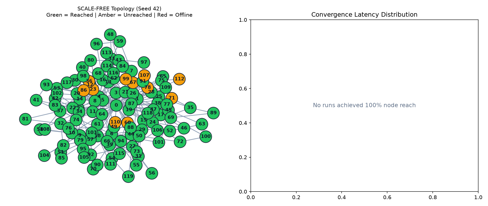

# Network Resilience Simulator (`netsim`)

[](https://github.com/kds1123001/network-resilience-sim/actions)
[](https://github.com/kds1123001/network-resilience-sim/releases)

A deterministic discrete-event and hybrid Python/C network resilience simulation toolkit for studying broadcast propagation, convergence latency, packet loss, node reboots, partition recovery, fault tolerance, and cluster gossip under adverse network conditions.

## Table of Contents

- [Overview](#overview)
- [Core Subsystems](#core-subsystems)
- [Network Topologies & Fault Models](#network-topologies--fault-models)
- [Repository Structure](#repository-structure)
- [Installation & Build](#installation--build)
- [Usage Guide](#usage-guide)
- [Metrics, Telemetry & Observability](#metrics-telemetry--observability)
- [Benchmarks & Charts](#benchmarks--charts)
- [Docker & CI Workflows](#docker--ci-workflows)
- [Troubleshooting](#troubleshooting)
- [Credits](#credits)

## Overview

Distributed systems rarely fail cleanly. Nodes reboot mid-broadcast, links drop packets probabilistically, partitions isolate subsets of peers, and duplicate messages amplify load across dense graphs. `network-resilience-sim` (`netsim`) provides a reproducible environment to model these behaviors, benchmark convergence across random seeds, inspect telemetry, and visualize performance trade-offs.

## Core Subsystems

### 1. Discrete-Event Simulation Engine
- **Priority-Queue Event Loop (`heapq`):** Advances simulated time deterministically by popping the earliest scheduled event rather than spinning on real wall-clock timers.
- **Node State Machine:** Tracks transitions across `HEALTHY`, `REBOOTING`, and `OFFLINE` states so you can see how downtime and recovery windows affect message reachability.
- **Link Dynamics:** Models configurable propagation delays, probabilistic packet drops, duplicate frame suppression, and scheduled or random node reboot/recovery cycles.

### 2. Multiple Network Topologies
- **`ring` (Chordal Ring):** Structured ring connectivity with chords for bounded hop counts and localized redundancy.
- **`mesh` (Complete Graph):** High path diversity with heavy fan-out and higher duplicate traffic if suppression is loose.
- **`random` (Erdos-Renyi):** Probabilistic edge generation for testing connectivity thresholds and sparse link failures.
- **`scale-free` (Barabasi-Albert):** Preferential-attachment hubs that expose single-point hub stress and cascading impact when high-degree nodes fail.

### 3. Monte Carlo Benchmarking
- Executes multi-seed experiment ensembles across topologies and fault configurations.
- Aggregates run-level outcomes into summary statistics (`mean`, `median` / `p50`, and tail `p95` convergence times), reachability rates, dropped packet counts, and suppressed duplicate counts.

### 4. Native C Engine, HMAC UDP Gossip & Observability
- **Native C Engine (`native/smart_sim.c`):** High-throughput arrival and simulation routines compiled with `-O3` as a shared library for fast event/arrival runs and benchmark generation.
- **HMAC UDP Gossip:** Peer-to-peer UDP state/health exchange signed with HMAC so forged or tampered frames are rejected.
- **Observability & Exports:** Emits JSON summary reports, flat CSV per-run logs, runtime counters, and charts saved under `docs/charts/`.

## Network Topologies & Fault Models

| Dimension | Supported Modes / Behaviors | What It Tests |
|---|---|---|
| **Topologies** | `ring`, `mesh`, `random`, `scale-free` | Hop count, path redundancy, hub bottlenecks, and duplicate amplification |
| **Node States** | `HEALTHY`, `REBOOTING`, `OFFLINE` | Availability during churn and recovery after restart windows |
| **Link & Message Faults** | Link delay, packet drop probability, duplicate suppression | Retransmission/propagation lag, lost broadcasts, and storm containment |
| **Partition / Isolation** | Node isolation and targeted fault injection | Split-brain / partial-reach behavior and post-heal convergence |

## Repository Structure

```text
network-resilience-sim/
|-- pyproject.toml              # Package metadata, dependencies, and `netsim` CLI script
|-- README.md                   # Project documentation
|-- native/
|   `-- smart_sim.c             # Native C simulation/arrival engine source
|-- docs/
|   `-- charts/                 # Benchmark and arrival visualizations (e.g., smart_c_arrival.png)
|-- src/
|   `-- netsim/                 # Engine, topologies, metrics, CLI, and reporting modules
|-- tests/
|   `-- test_engine.py          # Automated pytest suite
`-- .github/workflows/          # GitHub Actions CI test and build pipelines
```

## Installation & Build

### 1. Python Virtual Environment

Create a local virtual environment, activate it, upgrade `pip`, and install the project in editable mode:

```powershell
python -m venv .venv
.venv\Scripts\Activate.ps1
python -m pip install --upgrade pip
pip install -e .
```

### 2. Native C Shared Library (`native/smart_sim.c`)

Compile `native/smart_sim.c` into a shared library (`.dll` on Windows, `.so` on Linux):

```powershell
gcc -O3 -Wall -Wextra -std=c11 -shared -o smart_sim.dll .\native\smart_sim.c -lm
```

## Usage Guide

### CLI Inspection

Check top-level commands, flags, and module entry points:

```powershell
netsim --help
python -m netsim --help
```

### Running HMAC UDP Gossip Nodes

Start peer UDP gossip nodes with a shared secret key so peers authenticate incoming frames with HMAC and drop invalid payloads:

```powershell
# Node A
python -m gossip --bind 127.0.0.1:9001 --peers 127.0.0.1:9002 --hmac-key "replace-with-strong-secret"

# Node B
python -m gossip --bind 127.0.0.1:9002 --peers 127.0.0.1:9001 --hmac-key "replace-with-strong-secret"
```

- Keep `--hmac-key` consistent across nodes in the same cluster and isolate keys per test run.
- Use distinct local UDP ports (`9001`, `9002`, ...) when running multiple nodes on `127.0.0.1`.

## Metrics, Telemetry & Observability

- **Full-Reach Success Rate:** Percentage of seeds/runs where every reachable/healthy node receives the broadcast before simulation cutoff.
- **Average Reached Nodes:** Mean node coverage even when full cluster convergence is blocked by drops or outages.
- **Convergence Latency (`mean`, `p50`, `p95`):** Time delta from initial broadcast injection until propagation completes or stabilizes across seeds.
- **Dropped Packets:** Total packets lost due to simulated link drop rates or offline/rebooting targets.
- **Suppressed Duplicates:** Redundant messages filtered out instead of re-broadcasting across the graph.
- **Artifact Outputs:** Structured JSON for programmatic analysis, flat CSV for spreadsheet/pandas sweeps, and PNG plots under `docs/charts/`.

## Benchmarks & Charts

Visualizations generated and tracked under `docs/charts/` summarize arrival latency, throughput, reachability, and convergence behavior:



## Docker & CI Workflows

### Container Build & Run

```powershell
docker build -t network-resilience-sim:v0.2.0 .
docker run --rm network-resilience-sim:v0.2.0
```

### Continuous Integration

GitHub Actions workflows under `.github/workflows/` run automated checks on pushes and pull requests to keep Python package installation, simulation logic, and C builds healthy.

## Troubleshooting

- **`netsim` not recognized:** Confirm `.venv\Scripts\Activate.ps1` was run and `pip install -e .` completed inside the active `.venv`.
- **`gcc` `WinMain@16` linker error:** Compile `native\smart_sim.c` with `-shared` to produce `smart_sim.dll` rather than an `.exe`.
- **PowerShell command chaining:** Use `;` instead of `&&` in Windows PowerShell 5.1.

## Credits

- Created by [kds1123001](https://github.com/kds1123001)
- ALSO  NO FUCKING BODY CONTRIBUTED IN THIS SHIT ITS ALL JUST GITHUB ARTIFACT FUCKING ISSUES FUCK YOU GITHUB 
